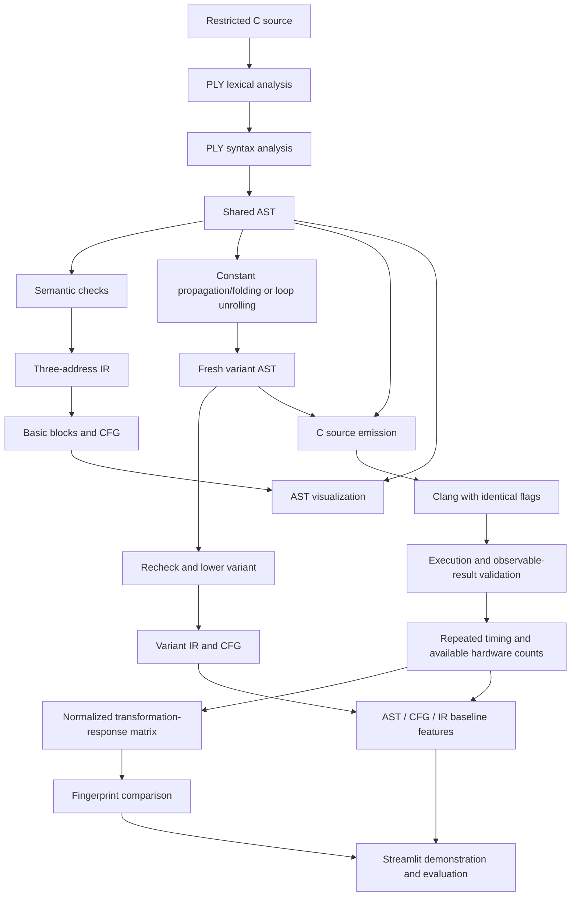

# Architecture

Status: Phases 1–3 implemented; Phases 4–7 remain design contracts. Updated
2026-10-16. Frontend, analysis, TAC/CFG, diagrams, transformations, reports and
pure C emission are operational; user C is not compiled or executed.

## Research pipeline

AST → CFG uses the common validated AST → IR lowering implemented in Phase 2.
This avoids two conflicting definitions of branch/loop execution order. Ishaan
owns CFG partitioning and edges; Zayn owns the preceding lowering. The custom
three-address IR is the lab's compiler IR; LLVM IR is a later inspection artifact,
not a substitute for implementing it.

## Boundaries and ownership

The Phase 1–3 signatures below are implemented; Phase 4 onward are **planned
APIs**, not callable functions today. `compiler/diagnostics.py` shares frontend
source mapping and exceptions, and `compiler/__main__.py` supplies the requested
`python -m compiler` CLI, now extended with semantic/TAC/CFG/graph inspection.
`compiler/semantic.py` isolates binding and dataflow analysis from typed IR and
lowering; `compiler.ir.validate` re-exports the original planned API. This small
module split avoids mixing the symbol environment with instruction construction.
Use Python dataclasses and type annotations, explicit result records, and
schema-versioned JSON. Do not pass PLY-specific objects between stages.

| File / phase | Owner | Interface and responsibility (Phases 1–3 implemented) |
| --- | --- | --- |
| `compiler/lexer.py` / 1 | Ishaan | `tokenize(source: str) -> list[TokenRecord]`; fresh PLY lexer per source; token value and source span |
| `compiler/parser.py` / 1 | Ishaan | `parse(source: str) -> Program`; PLY grammar, precedence, AST construction; fail with structured diagnostics |
| `compiler/ast_nodes.py` / 1 | Ishaan | Common nodes and `SourceSpan`; `ast_to_dict(program) -> dict` for deterministic structured output |
| `compiler/semantic.py` / 2 | Zayn | `analyze(program) -> SemanticAnalysis`, `validate(program) -> None`; lexical binding, initialization/dataflow, diagnostics |
| `compiler/ir.py` / 2 | Zayn | Re-exports `validate`; `lower_ir(program: Program) -> IRProgram` validates and performs real three-address lowering; `format_ir(ir) -> str` |
| `compiler/cfg.py` / 2 | Ishaan | `build_cfg(ir: IRProgram) -> ControlFlowGraph`; leaders, blocks, typed edges, entry/exit |
| `visualization/graph_renderer.py` / 2 | Ishaan | `ast_to_dot(program) -> str`, `cfg_to_dot(cfg) -> str`, `render(dot, path, format) -> Path`; deterministic DOT, optional external rendering |
| `transformations/constant_folding.py` / 3 | Zayn | `propagate_and_fold(program: Program) -> TransformationResult`; scoped constant environments and safe arithmetic |
| `transformations/loop_unrolling.py` / 3 | Zayn | `unroll_loops(program: Program, max_iterations: int = 32) -> TransformationResult`; conservative eligibility and skipped-loop reasons |
| `transformations/common.py` / 3 | Zayn | Fresh AST cloning/provenance, safe integer arithmetic, immutable statistics/decisions/reports and transactional revalidation |
| `transformations/pipeline.py` / 3 | Zayn / Pranav | `apply_transformations(program, sequence=("constants", "unroll"), max_iterations=32) -> PipelineResult`; exact ordered passes, composed provenance and report JSON |
| `compiler/codegen.py` / 3 | Zayn | `emit_c(program: Program) -> str`, re-exported through `compiler.ir`; fully parenthesized subset C, no execution |
| `runtime/compiler_runner.py` / 4 | Pranav | `compile_source(source, config) -> CompilationResult`, `execute(artifact, case, config) -> ExecutionResult`; no shell interpolation |
| `runtime/benchmark.py` / 5 | Pranav | `benchmark(variants, cases, config) -> BenchmarkReport`; raw samples, aggregation, validation, and provenance |
| `fingerprint/matrix.py` / 6 | Pranav | `build_matrix(report) -> ResponseMatrix`; schema alignment, normalization, and missing masks |
| `fingerprint/similarity.py` / 6 | Pranav | `compare(left, right, config) -> SimilarityResult`; overlap coverage and defined metrics |
| `app.py` / 7 | All; Pranav integrates | Presentation over those APIs; no duplicate compiler or measurement logic |

The emitter is a small `compiler/codegen.py` module so formatting/round-trip
concerns remain separate from typed IR and recursive lowering. The planned
`compiler.ir.emit_c` API is retained by re-export. No compiler-runner module is
needed for pure source emission. Shared transformation contracts and sequencing
also have small dedicated modules to avoid duplicating safety/report logic.

## Shared records

### Frontend and analysis

- `SourceSpan`: one-based line/column positions; zero-based character offsets,
  exclusive end. Preserve original text positions through comments and whitespace.
- `TokenRecord`: token type, typed value, original lexeme, span.
- `Diagnostic`: stage, stable code, message, span if available. Lexing and parsing
  raise dedicated exceptions containing diagnostics; no partial AST on failure.
  Phase 2 adds the `semantic` stage, `SemanticError`, and optional `severity`
  (`error` by default, `warning` for unreachable statements). Existing Phase 1
  constructor calls and error strings retain their behavior.
- `Program`: schema version, one `main` function; nodes described in
  [COMPILER_DESIGN.md](COMPILER_DESIGN.md). Analysis annotations remain separate
  from syntax nodes so transformations do not corrupt the baseline.
- `IRProgram`: ordered instructions, explicit labels, symbol table and source
  provenance. `ControlFlowGraph`: block IDs, instruction lists, typed edges.
  Stable IDs are internal identities, not similarity features.

`SemanticAnalysis` holds immutable `symbols`, node-to-symbol `bindings`, warning
`diagnostics`, and `unreachable_node_ids`. It never mutates the AST. The binder
checks every reference, including dead syntax; the checker evaluates conservative
flow facts and omits evaluated-read/arithmetic checks for structurally dead source.
Every declared variable name is unique throughout `main`; nested/disjoint blocks
cannot reuse a name. Block and `for` scopes restrict visibility independently.
Definite initialization joins continuing branches by intersection. A loop can run
zero times; loop-written constants are discarded to avoid stale diagnostic facts.
Both arms of even a literal conditional remain possible. These rules are a
conservative subset validator, not a proof of runtime arithmetic safety.

IR records use `Constant`, `SymbolRef(symbol_id, name)`, and `TempRef(name)`.
Every instruction retains AST `node_id` and `span`; `IRProgram` has
`instructions`, `symbols`, `schema_version=1`, and warning `diagnostics`. Text
formats use `%t0` temporaries and `L0` labels, deterministic per lowering. Lowering
alone never folds arithmetic or prunes constant branch edges; Phase 3 explicitly
rewrites AST expressions before normal lowering. Structurally dead source
following an unconditional return is warned and omitted while lowering. Loop
conditions are recomputed at their header, and only continuing body paths reach
the update/back edge.

CFG records use `BasicBlock(block_id, instructions, reachable)`,
`Edge(source, target, kind)` and `ControlFlowGraph(blocks, edges, entry, exit)`.
Entry/exit are synthetic IDs; blocks are `B0`, `B1`, ... in TAC order. Leaders are
entry, every label and every post-terminator instruction. Reachability is graph
reachability over both conditional edges, not a runtime-path claim. Malformed
hand-built TAC (invalid operands/operators, duplicate/unresolved labels) is rejected
with `ValueError`; source programs are semantically validated before lowering.

`ast_to_dot` and `cfg_to_dot` are deterministic, pure-Python exporters with escaped
labels. They do not require an external executable. `render` saves the `.dot`
sidecar before optional Graphviz SVG/PNG/PDF rendering. Missing or failed renderers
raise `GraphRenderError` (including `GraphvizUnavailableError`) with `dot_path`,
so the CLI can report an actionable error and preserve inspectable output.
Graphviz 16.1.0 was used for actual AST and CFG render validation in Phase 2.

### Transformations

`TransformationResult(program, report, origins)` contains a fresh program, an
immutable `TransformationReport`, and read-only output-node-to-input-node origins.
Report fields are `name`, `version="1"`, `status`, `parameters`, `statistics` and
`decisions`. Statistics count actual committed folds, propagated reads, replaced
loops, expanded iterations and changed AST nodes. Decisions include source
node IDs/spans, reason codes/messages and rejected/not-applicable outcomes.

Status is `applied` when a change commits (possibly with decisions for other
loops), `rejected` when no change commits and safety decisions reject candidates,
or `not_applicable` when no eligible opportunity exists. Source-invalid inputs
raise the existing semantic diagnostics. Every candidate is revalidated; a failed
candidate rolls back the whole pass to a fresh input clone with zero committed
statistics and `REVALIDATION_FAILED`. Reports are JSON-serializable and contain
no timings or hardware values.

All syntax nodes are rebuilt. One-to-one nodes preserve deterministic IDs/spans;
duplicated bodies/updates receive collision-free `u0`, `u1`, ... IDs. Origin maps
retain initial source provenance, including after composition and rollback. Raw
`fold_expression()` is an expression-only safety helper; full program passes
validate both input and candidate. Signed arithmetic helpers use C truncation
toward zero/remainder and refuse undefined results rather than Python overflow
or signed floor-division semantics.

The environment for `propagate_and_fold` maps symbol IDs to known integers.
Assignments replace/invalidate facts, branches join agreeing values on continuing
paths, and loops kill written entry facts before condition/body processing and
again on exit. Body-established facts can feed the update on every continuing
path. Block/loop-local facts are removed at scope exit. Control flow remains
explicit; no speculative branch pruning or unsafe algebraic identities occur.

`unroll_loops` proves canonical constant-expression loop counts mathematically,
including positive/negative compatible steps, `< <= > >=` bounds, zero trips,
and final-update signed-range safety. Bodies are assignment/block/empty only;
induction writes, declarations, branches, returns and nested loops are rejected.
Expansion retains initializer/body/update order and a block for loop scope.
Default maximum is 32; supported configuration range is 0..1024.

Individual calls can create independent variants of the same baseline.
`apply_transformations` additionally supports explicit ordered combinations;
`PipelineResult` exposes the fresh program, exact sequence, reports, and origins
composed back to the initial AST. It continues after a rejected pass using that
pass's valid preserved input. A repeated constant pass is stable; already
expanded loops are no longer opportunities. Selection is deterministic; adaptive
selection remains future research, not an implemented feature.

`emit_c` produces canonical, semantically validated subset C with explicit
parentheses, braces and retained names/scopes. Folded negative literal nodes are
emitted through supported unary syntax; INT_MIN uses `(-2147483647 - 1)` to
respect the unchanged frontend literal bound. Emitted sources are round-tripped
through parse/analyze/TAC/CFG in tests. Phase 3 tests check independently expected
values with pure arithmetic/TAC oracles, not Clang or process equivalence.

### Runtime and measurements

`CompileConfig`: compiler path/version, C standard, flags, target and timeout.
Initially use controlled `-std=c11 -O0` experiments to reduce optimizer masking;
`-O2` is a separately labeled evaluation condition, never mixed into one matrix.
Even at `-O0`, trivial programs may yield weak or indistinguishable responses.

`CompilationResult`: success/failure/timeout, exact command, diagnostics, artifact
path, source hash and compiler metadata. `ExecutionCase`: stable ID, stdin bytes,
argument list, environment, fixture/parameter provenance. V1 cases use empty
stdin/arguments and controlled literal source fixtures because user programs
have no input operations. Every variant receives the same case and environment.

`ExecutionResult`: stdout/stderr, process status, termination reason, elapsed
nanoseconds, and full integer return observation when the validation harness is
enabled. POSIX process exit status alone loses return-value information; Phase 4
must observe full returns using a controlled C wrapper or equivalent backend.
Phase 3 supplies test-only expected integer checks without a process harness.
A future generated wrapper may rename `main` and print its returned `int`;
wrapper code is internal C, outside the accepted user syntax. Apply the same
wrapper to all variants and record it in experiment metadata. Full-return
validation precedes measurement, and successful runs do not prove equivalence
for all possible programs or inputs.

`BenchmarkReport` stores original/variant IDs, applied-pass reports, case IDs,
raw samples, warmups/repetition count, ordered/interleaved run schedule, medians,
dispersion, compiler/OS/CPU/dependency versions and environment. Failed or
non-equivalent variants cannot produce valid fingerprint cells.

Every metric has a value or `null`, unit, backend, scope and missing reason:

| Metric | Unit and scope | Availability |
| --- | --- | --- |
| `wall_time_ns` | Monotonic elapsed wall time; declared process/harness scope | macOS and Linux; includes startup unless a later backend isolates kernel work |
| `hardware_instructions` | Executed hardware instructions; declared `perf` event modifiers and process scope | Linux with working counters and permission |
| `static_tac_instructions` | Count of actual custom IR instructions, excluding labels | Both platforms after IR generation; separate structural baseline |

Never silently substitute one metric for another. Save JSON as the canonical
schema and CSV as long-form rows with explicit statuses; blanks represent
missing values, zero remains a real measurement. Future generated artifacts live
under `results/<run_id>/` and are ignored; deliberately curated evaluation data
can be explicitly versioned after review.

### Fingerprint contract

Rows are named transformations (including their parameters), columns are metric
and execution-case identities. Baseline records are retained separately.
For a finite positive baseline `b` and valid variant value `v`, use
`response = (v - b) / b`. Negative responses mean a reduction. A zero, negative,
missing or non-finite baseline gives a missing cell with a reason. Skipped
transformations are `not_applicable`, not numerical zero. Applied passes with
unchanged measurements can legitimately produce zero.

Compare only compatible schemas, pass versions/parameters, case identities,
metric units/backends and experiment conditions. Compute distances over common
valid cells, expose the common-cell count and coverage, and return unavailable
when overlap is insufficient. Initial candidates are Euclidean distance and
cosine similarity; zero-norm vectors make cosine unavailable. Thresholds are
calibrated against held-out examples, not presented as probabilities or proofs.

## Integration policy

Phases 1–3 preserve frontend/analysis interfaces and supply fresh transformed ASTs,
source emission, provenance and explicit sequence reports. Emitted baseline and
variant source plus case identity are the Phase 4 boundary. Phase 3 validation
uses pure expected-value/round-trip tests and no Clang/process harness, following
the current request's strict boundary. Compilation, execution, subprocess control,
full-return runtime equivalence and timeouts all begin in Phase 4.

Every phase adds unit tests and any justified integration tests, updates progress,
and passes its acceptance gate before the next phase starts. Interface changes
must update this document and affected consumers in the same change. Local setup
uses standard [Python packaging metadata](https://packaging.python.org/en/latest/guides/writing-pyproject-toml/)
and [pytest configuration](https://docs.pytest.org/en/stable/reference/customize.html).

No network services, database or process sandbox is required for the local lab
setup. Future execution accepts trusted local fixtures; exposing compilation of
arbitrary uploads requires a separate isolation decision before deployment.
