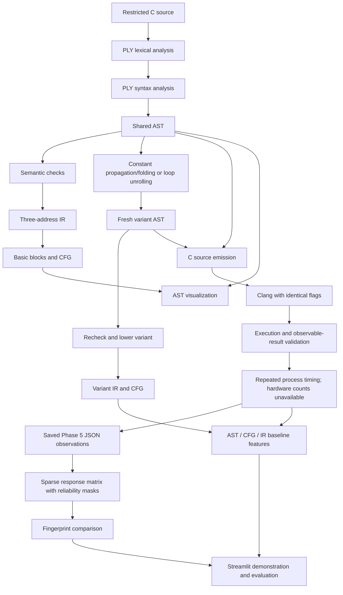

# Architecture

Status: Phases 1–6 accepted; Phase 7 remains a design contract.
Updated 2026-10-18.
Frontend, analysis, TAC/CFG, diagrams, transformations, reports and
pure C emission, Clang compilation, full-return execution and observed equivalence
are operational. Repeated end-to-end process measurement is implemented; actual
baseline evidence is recorded; the serial acceptance suite passed all 1384 cases.
Response matrices, explicit configuration fingerprints and interpretable
comparisons consume saved observations without recompilation. The full Phase 6
gate passed all 1709 tests, retaining all 1384 prior cases. Phase 7 has not begun.

## Research pipeline

AST → CFG uses the common validated AST → IR lowering implemented in Phase 2.
This avoids two conflicting definitions of branch/loop execution order. Ishaan
owns CFG partitioning and edges; Zayn owns the preceding lowering. The custom
three-address IR is the lab's compiler IR; LLVM IR is a later inspection artifact,
not a substitute for implementing it.

## Boundaries and ownership

The Phase 1–6 signatures below are implemented and accepted. Phase 7 APIs remain
planned. `compiler/diagnostics.py` shares frontend
source mapping and exceptions, and `compiler/__main__.py` supplies the requested
`python -m compiler` CLI, now extended with semantic/TAC/CFG/graph inspection.
`compiler/semantic.py` isolates binding and dataflow analysis from typed IR and
lowering; `compiler.ir.validate` re-exports the original planned API. This small
module split avoids mixing the symbol environment with instruction construction.
Use Python dataclasses and type annotations, explicit result records, and
schema-versioned JSON. Do not pass PLY-specific objects between stages.

| File / phase | Owner | Interface and responsibility (Phases 1–6 implemented) |
| --- | --- | --- |
| `compiler/lexer.py` / 1 | Ishaan | `tokenize(source: str) -> list[TokenRecord]`; fresh PLY lexer per source; token value and source span |
| `compiler/parser.py` / 1 | Ishaan | `parse(source: str) -> Program`; PLY grammar, precedence, AST construction; fail with structured diagnostics |
| `compiler/ast_nodes.py` / 1 | Ishaan | Common nodes and `SourceSpan`; `ast_to_dict(program) -> dict` for deterministic structured output |
| `compiler/semantic.py` / 2 | Zayn | `analyze(program) -> SemanticAnalysis`, `validate(program) -> None`; lexical binding, initialization/dataflow, diagnostics |
| `compiler/ir.py` / 2 | Zayn | Re-exports `validate`; `lower_ir(program: Program) -> IRProgram` validates and performs real three-address lowering; `format_ir(ir) -> str` |
| `compiler/cfg.py` / 2 | Ishaan | `build_cfg(ir: IRProgram) -> ControlFlowGraph`; leaders, blocks, typed edges, entry/exit |
| `visualization/graph_renderer.py` / 2 | Ishaan | `ast_to_dot(program) -> str`, `cfg_to_dot(cfg) -> str`, `render(dot, path, format) -> Path`; deterministic DOT, optional external rendering |
| `transformations/constant_folding.py` / 3 | Zayn | `propagate_and_fold(program: Program) -> TransformationResult`; scoped constant environments and safe arithmetic |
| `transformations/loop_unrolling.py` / 3 | Zayn | `unroll_loops(program: Program, max_iterations: int = 32) -> TransformationResult`; conservative eligibility and skipped-loop reasons |
| `transformations/common.py` / 3 | Zayn | Fresh AST cloning/provenance, safe integer arithmetic, immutable statistics/decisions/reports and transactional revalidation |
| `transformations/pipeline.py` / 3 | Zayn / Pranav | `apply_transformations(program, sequence=("constants", "unroll"), max_iterations=32) -> PipelineResult`; exact ordered passes, composed provenance and report JSON |
| `compiler/codegen.py` / 3 | Zayn | `emit_c(program: Program) -> str`, re-exported through `compiler.ir`; fully parenthesized subset C, no execution |
| `runtime/models.py` / 4 | Pranav | Immutable `CompileConfig`, `ExecutionCase`, compiler/artifact/compilation/execution records |
| `runtime/compiler_runner.py` / 4–5 | Pranav | Context-managed `CompilerRunner(config)` with `compile_source(source, label=..., observation_file=...)`, unchanged `execute(artifact, case=None)`, and `timed_execute(artifact, case=None) -> TimedExecution`; module delegates require `workspace=runner` |
| `runtime/harness.py` / 4 | Pranav | `make_harness(program) -> HarnessSource`; strict `parse_observation(text) -> int`; full signed return and target assertions |
| `runtime/equivalence.py` / 4–5 | Pranav / Zayn | Existing `check_equivalence`, `compare_sources`, `evaluate_source`; `prepared_equivalence(...)` yields the same validation report and live owning runner for exact-binary reuse |
| `runtime/benchmark_models.py` / 5 | Pranav | `BenchmarkConfig`, `TimedExecution`, `BenchmarkSample`, `BenchmarkReport`; explicit timing scope, JSON and limitations |
| `runtime/benchmark.py` / 5 | Pranav | `benchmark(source, sequence=("constants",), config=..., comparison_source=..., benchmark_id=...) -> BenchmarkReport`; full-observation gate, AB/BA schedule, failure invalidation and concise summary |
| `runtime/benchmark_statistics.py` / 5 | Pranav | `summarize(durations)` and `compare_summaries(original, transformed)`; pure finite descriptive statistics and reliability flags |
| `runtime/benchmark_storage.py` / 5 | Pranav | `raw_rows`, `summary_rows`, `validate_output_paths`, `save_report`; fixed CSV schemas, strict JSON and input-preserving atomic files |
| `fingerprint/models.py` / 6 | Pranav | Detached `ResponseMatrix`, `Fingerprint`, `ComparisonResult`; strict JSON, schema/feature validation, canonical content hashes and stable identifiers |
| `fingerprint/matrix.py` / 6 | Pranav | `build_matrix(reports) -> ResponseMatrix`; validates Phase 5 dicts/records, sparse axes, deterministic structural extraction, normalization, timing audit and retained provenance |
| `fingerprint/extraction.py` / 6 | Pranav | `extract_fingerprint(matrix, configuration_id=None, source_ids=None, pipeline_ids=None, observation_ids=None) -> Fingerprint`; exactly one complete configuration, explicit observation filters, no averaging |
| `fingerprint/similarity.py` / 6 | Pranav | `ComparisonConfig` and `compare(left, right, config=None) -> ComparisonResult`; explicit alignment, reliability masks, bounded numeric/categorical differences, contributions and coverage |
| `fingerprint/storage.py` / 6 | Pranav | `load_document`, `save_document`, `feature_rows`, `comparison_rows`; versioned lossless JSON, long-form CSV, protected inputs and atomic per-file replacement |
| `fingerprint/cli.py` / 6 | Pranav | Additive `--matrix`, `--fingerprint`, `--compare-fingerprints` dispatch in the existing CLI; saved-report import, selection, inspection and exports; no compilation/execution |
| `app.py` / 7 | All; Pranav integrates | Presentation over those APIs; no duplicate compiler or measurement logic |

The emitter is a small `compiler/codegen.py` module so formatting/round-trip
concerns remain separate from typed IR and recursive lowering. The planned
`compiler.ir.emit_c` API is retained by re-export. No compiler-runner module is
needed for pure source emission. Shared transformation contracts and sequencing
also have small dedicated modules to avoid duplicating safety/report logic.

## Shared records

### Frontend and analysis

- `SourceSpan`: one-based line/column positions; zero-based character offsets,
  exclusive end. Preserve original text positions through comments and whitespace.
- `TokenRecord`: token type, typed value, original lexeme, span.
- `Diagnostic`: stage, stable code, message, span if available. Lexing and parsing
  raise dedicated exceptions containing diagnostics; no partial AST on failure.
  Phase 2 adds the `semantic` stage, `SemanticError`, and optional `severity`
  (`error` by default, `warning` for unreachable statements). Existing Phase 1
  constructor calls and error strings retain their behavior.
- `Program`: schema version, one `main` function; nodes described in
  [COMPILER_DESIGN.md](COMPILER_DESIGN.md). Analysis annotations remain separate
  from syntax nodes so transformations do not corrupt the baseline.
- `IRProgram`: ordered instructions, explicit labels, symbol table and source
  provenance. `ControlFlowGraph`: block IDs, instruction lists, typed edges.
  Stable IDs are internal identities, not similarity features.

`SemanticAnalysis` holds immutable `symbols`, node-to-symbol `bindings`, warning
`diagnostics`, and `unreachable_node_ids`. It never mutates the AST. The binder
checks every reference, including dead syntax; the checker evaluates conservative
flow facts and omits evaluated-read/arithmetic checks for structurally dead source.
Every declared variable name is unique throughout `main`; nested/disjoint blocks
cannot reuse a name. Block and `for` scopes restrict visibility independently.
Definite initialization joins continuing branches by intersection. A loop can run
zero times; loop-written constants are discarded to avoid stale diagnostic facts.
Both arms of even a literal conditional remain possible. These rules are a
conservative subset validator, not a proof of runtime arithmetic safety.

IR records use `Constant`, `SymbolRef(symbol_id, name)`, and `TempRef(name)`.
Every instruction retains AST `node_id` and `span`; `IRProgram` has
`instructions`, `symbols`, `schema_version=1`, and warning `diagnostics`. Text
formats use `%t0` temporaries and `L0` labels, deterministic per lowering. Lowering
alone never folds arithmetic or prunes constant branch edges; Phase 3 explicitly
rewrites AST expressions before normal lowering. Structurally dead source
following an unconditional return is warned and omitted while lowering. Loop
conditions are recomputed at their header, and only continuing body paths reach
the update/back edge.

CFG records use `BasicBlock(block_id, instructions, reachable)`,
`Edge(source, target, kind)` and `ControlFlowGraph(blocks, edges, entry, exit)`.
Entry/exit are synthetic IDs; blocks are `B0`, `B1`, ... in TAC order. Leaders are
entry, every label and every post-terminator instruction. Reachability is graph
reachability over both conditional edges, not a runtime-path claim. Malformed
hand-built TAC (invalid operands/operators, duplicate/unresolved labels) is rejected
with `ValueError`; source programs are semantically validated before lowering.

`ast_to_dot` and `cfg_to_dot` are deterministic, pure-Python exporters with escaped
labels. They do not require an external executable. `render` saves the `.dot`
sidecar before optional Graphviz SVG/PNG/PDF rendering. Missing or failed renderers
raise `GraphRenderError` (including `GraphvizUnavailableError`) with `dot_path`,
so the CLI can report an actionable error and preserve inspectable output.
Graphviz 16.1.0 was used for actual AST and CFG render validation in Phase 2.

### Transformations

`TransformationResult(program, report, origins)` contains a fresh program, an
immutable `TransformationReport`, and read-only output-node-to-input-node origins.
Report fields are `name`, `version="1"`, `status`, `parameters`, `statistics` and
`decisions`. Statistics count actual committed folds, propagated reads, replaced
loops, expanded iterations and changed AST nodes. Decisions include source
node IDs/spans, reason codes/messages and rejected/not-applicable outcomes.

Status is `applied` when a change commits (possibly with decisions for other
loops), `rejected` when no change commits and safety decisions reject candidates,
or `not_applicable` when no eligible opportunity exists. Source-invalid inputs
raise the existing semantic diagnostics. Every candidate is revalidated; a failed
candidate rolls back the whole pass to a fresh input clone with zero committed
statistics and `REVALIDATION_FAILED`. Reports are JSON-serializable and contain
no timings or hardware values.

All syntax nodes are rebuilt. One-to-one nodes preserve deterministic IDs/spans;
duplicated bodies/updates receive collision-free `u0`, `u1`, ... IDs. Origin maps
retain initial source provenance, including after composition and rollback. Raw
`fold_expression()` is an expression-only safety helper; full program passes
validate both input and candidate. Signed arithmetic helpers use C truncation
toward zero/remainder and refuse undefined results rather than Python overflow
or signed floor-division semantics.

The environment for `propagate_and_fold` maps symbol IDs to known integers.
Assignments replace/invalidate facts, branches join agreeing values on continuing
paths, and loops kill written entry facts before condition/body processing and
again on exit. Body-established facts can feed the update on every continuing
path. Block/loop-local facts are removed at scope exit. Control flow remains
explicit; no speculative branch pruning or unsafe algebraic identities occur.

`unroll_loops` proves canonical constant-expression loop counts mathematically,
including positive/negative compatible steps, `< <= > >=` bounds, zero trips,
and final-update signed-range safety. Bodies are assignment/block/empty only;
induction writes, declarations, branches, returns and nested loops are rejected.
Expansion retains initializer/body/update order and a block for loop scope.
Default maximum is 32; supported configuration range is 0..1024.

Individual calls can create independent variants of the same baseline.
`apply_transformations` additionally supports explicit ordered combinations;
`PipelineResult` exposes the fresh program, exact sequence, reports, and origins
composed back to the initial AST. It continues after a rejected pass using that
pass's valid preserved input. A repeated constant pass is stable; already
expanded loops are no longer opportunities. Selection is deterministic; adaptive
selection remains future research, not an implemented feature.

`emit_c` produces canonical, semantically validated subset C with explicit
parentheses, braces and retained names/scopes. Folded negative literal nodes are
emitted through supported unary syntax; INT_MIN uses `(-2147483647 - 1)` to
respect the unchanged frontend literal bound. Emitted sources are round-tripped
through parse/analyze/TAC/CFG in tests. Phase 3 tests check independently expected
values with pure arithmetic/TAC oracles, not Clang or process equivalence.

### Runtime (implemented in Phase 4)

`CompileConfig` fixes C11 and the signed 32-bit target; it configures the Clang
path/name, O0 or O2, compilation/execution deadlines, sanitizer mode, bounded
output and optional address-space limit. UBSan is enabled by default. Extra flags
are diagnostic-only so they cannot override semantics, target or sanitization.
Clang's path/version is discovered once into `CompilerInfo`. A runner context
owns private independent builds and fresh run directories, cleaning every artifact
on exit. Top-level compile/execute delegates require that explicit context.

`CompilationResult` retains status, exact command, stdout/stderr, process code,
details, source SHA-256 and an ephemeral typed `CompiledArtifact` when successful.
`ExecutionCase` contains stdin bytes, arguments and environment overrides. The
high-level V1 service uses empty stdin/arguments because the existing subset has
no input operations. Both variants receive the same environment snapshot and
enforced locale/TZ/UBSan settings. `ExecutionResult` separates `return_value`
(full signed integer) from `process_returncode` and signal/status, and retains
stdout/stderr/details. These Phase 4 records retain their public fields:
`ExecutionResult` has **no elapsed-time field**. Phase 5 adds a separate
`TimedExecution(execution, duration_ns)` wrapper.

The harness receives an AST, validates/emits/round-trips canonical subset C and
renames only the emitter's verified opening header to a collision-free static
entry. Standard headers follow the computation to protect accepted identifiers
from header macros. The wrapper calls the computation once and writes a strict
versioned JSON result file separately from stdout/stderr. Its own status is 0 on
success; the returned integer is never inferred from OS exit status. C static
assertions require 8-bit bytes, four-byte int and exact signed 32-bit bounds.
Internal wrapper C does not extend the source grammar.

The checker reuses parse/analyze, the ordered Phase 3 pipeline, revalidation and
the existing emitter. A known-valid capability program verifies target/sanitizer
compilation/startup. Baseline and candidate compile and run independently with
identical flags. Compare complete integer values, stdout, stderr and normal
status. Outcomes distinguish observed equivalence, differences, compilation or
execution failures, timeout, undefined behavior, unavailability/inconclusiveness
and no accepted transformation. UBSan-disabled matching pairs are inconclusive;
rejected/unchanged pipelines are never accepted as transformation evidence.

Schema-1 reports separate deterministic `result` from `environment_metadata`.
Result stores input hashes, canonical sources, harness hashes, settings, ordered
pass applicability, composed origins, compilation diagnostics and observations.
Temporary paths in diagnostics normalize to `<workspace>`; raw commands/paths,
compiler version and platform/Python details remain environmental. Artifact paths
are historical provenance after context cleanup. A successful comparison is
observed equivalence under these conditions, not a universal mathematical proof.

Timeout/output overflow kills subprocess groups; bounded file-backed captures and
available POSIX CPU/core/file-size/optional address-space limits contain accidental
runaway fixtures. This is not a filesystem/network security sandbox. Only trusted
local sources are appropriate. Actual execution coverage is macOS arm64, Apple
Clang 21.0.0, O0/O2; Linux remains unverified. See
[actual Phase 4 evidence](PHASE4_VALIDATION.md).

### Measurements (Phase 5 complete)

The benchmark uses the existing parser, transformations, emitter and Clang runner.
`prepared_equivalence` keeps the Phase 4 owning context alive after its capability
check and independent baseline/variant validation. Only `observed_equivalent`
permits sampling. The same sanitized artifacts are reused; compilation and the
initial validation executions are outside the measured series. Unchanged or
rejected pipelines, mismatches, UB, timeouts and unavailable/inconclusive
validation retain their status and do not produce a timing comparison.

`BenchmarkConfig` contains the existing `CompileConfig`, `warmups=5`,
`repetitions=30` and `max_iterations=32`. Warm-ups accept 0..10000 and measurements
1..10000 per variant. Every phase uses deterministic alternating pairs: round 0
original/transformed, round 1 transformed/original, then repeat. Warm-ups are
untimed but retain full observations. Measured executions check the same full
return, streams, signal and wrapper status on every repetition. Any failed,
divergent or interrupted run stops the schedule. All attempted rows survive,
but both aggregate groups are unavailable/invalid; no successful prefix is
silently averaged after a failed comparison.

`CompilerRunner.timed_execute` uses the existing execution path, not a separate
process pipeline. `duration_ns` uses `time.perf_counter_ns()` immediately before
`Popen` through process reaping, process-group cleanup and bounded capture-thread
completion. Scope is `end_to_end_process_execution`: process creation/startup,
child resource setup, sanitizer, computation, C observation-file write, capture
and supervision are included. Compilation, run-directory/input preparation,
Python capture decoding and observation JSON parsing are excluded. Clock units
do not establish clock accuracy or isolate computation. No overhead calibration,
subtraction or batching into a new native harness is performed.

The pure statistics module retains all supplied durations. A complete group of
nonnegative built-in integer nanoseconds yields count, median/mean, min/max,
sample standard deviation (`n-1`), inclusive R7 quartiles/IQR and coefficient of
variation (`stdev/mean` when defined). One sample has missing standard deviation;
zero is a real duration. Invalid/missing samples or non-finite results invalidate
the whole group. Process median ratio is `original/transformed`; percentage
change is `100*(transformed-original)/original`, with independently checked
denominators. Small counts, clock-resolution concerns, high CV, IQR overlap and
dispersion relative to the median gap produce descriptive flags. They are not
significance tests or evidence of algorithmic speedup. The high-level pipeline
always discloses startup scope, including at O2 where Clang may already perform
the source transformation.

Schema-1 benchmark JSON has `benchmark_id`, the Phase 4 deterministic `analysis`,
`environment_metadata` (compiler/platform/clock/artifact provenance), and
`benchmark` (settings, raw samples, groups, comparison, metric availability and
limitations). Raw samples retain phase, actual order/round/variant, duration,
units/scope, full execution record, expected-observation match, validity and
issue. Sample commands refer to historical temporary paths after cleanup.
Measured timings and benchmark IDs are not deterministic compiler-analysis
results. Record/field ordering and re-export of one report are repeatable.

| Quantity | Unit and scope | Implemented policy |
| --- | --- | --- |
| `samples[].duration_ns` | Nanoseconds; end-to-end process execution | Real monotonic readings for measured attempts; warm-ups/absent readings are `null` |
| `hardware_instructions` | Instructions; executed hardware instructions | `value=null`, `backend=null`, `status=unavailable`, explicit reason; no counter backend or `perf` requirement |
| Static TAC operations | Count of actual custom IR instructions, excluding labels | Separate structural quantity; not a substitute for hardware counts and not added to benchmark samples |

Canonical JSON rejects NaN/Infinity. Separate raw and aggregate CSV files have
fixed column order, explicit nanosecond fields and dimensionless ratios; missing
values are blank and genuine zeros remain zero. `benchmark_id` joins every row
to JSON. `validate_output_paths` checks all input/output aliases before work;
final output symlinks, directories and special files are refused. Existing
regular outputs may be replaced. Serialization finishes before directory creation,
all sibling temporary files are prepared before replacement, and each file is
atomically replaced; the set of exports is not one transaction. Generated reports
live under ignored `results/<benchmark_id>/` by default. Exact schemas, math,
commands, actual baseline samples and passing test-gate evidence are in
[PHASE5_VALIDATION.md](PHASE5_VALIDATION.md).

### Response matrices and fingerprints (Phase 6 accepted)

Phase 6 imports the complete schema-1 Phase 5 report rather than inventing a new
execution pipeline. `build_matrix` verifies report structure, stored source and
pass information, and the consistency of timed samples/summaries. It reparses
saved canonical subset C through existing semantic/TAC/CFG APIs for deterministic
structural counts. It performs no Clang invocation or new timing. The unchanged
original report remains in each observation's provenance.

The matrix is sparse, with named top-level `sources`, `pipelines`,
`configurations` and `observations` axes, plus `feature_definitions`. Source
identity uses the original input SHA-256; canonical-source hashes are separate.
Pipeline identity includes exact pass order, versions, parameters, unroll limit
and independent-source comparison context. Configuration identity contains
actual compiler path/version/target, flags, optimization, execution case,
timeouts/resource settings, platform/machine/Python/clock and measurement
protocol. It is more specific than a label such as O0. Observation IDs include
the full imported evidence, retaining genuinely repeated experiments separately;
identical report imports deduplicate. Missing Cartesian combinations are absent,
not zero-filled.

Schema-1 documents use kinds `codedna.response_matrix`, `codedna.fingerprint`
and `codedna.comparison`, with feature schema `codedna.features.v1`. Definitions
contain stable name, group, kind, unit, description and comparison rule. Every
feature has value, validity, reliability, reasons and provenance linking its
observation/report hash and JSON pointer or structural derivation. Exported
dictionaries are detached from stored records. Strict JSON rejects duplicate keys,
non-finite numbers and malformed versioned records.

Feature groups remain distinct:

| Group | Evidence |
| --- | --- |
| `structural` | Ordered pass applicability; committed folding/propagation/unrolling statistics; original/transformed static TAC and CFG counts; static deltas/responses |
| `compiler` | Recorded compilation/execution statuses, observed-equivalence outcome and benchmark schedule outcome; these are categorical observations |
| `performance` | Recorded process medians/ratio, normalized duration response and explicit unavailable hardware instructions, all retaining timing reliability |

For a finite positive baseline `b` and finite nonnegative variant `v`, response
is `(v-b)/b`; negative values mean a reduction. Nonpositive/missing/non-finite
baselines give a missing feature with a reason. No applied pass makes the
transformation response `not_applicable`; reported numeric zero counts remain
real zeros. Applied unchanged observations can have a genuine zero response.
Transformation signatures describe source and pipeline behavior rather than
independent compiler-performance evidence.

`extract_fingerprint` requires exactly one complete configuration after its
explicit filters. If several remain, the caller must select a configuration ID;
there is no silent merging across O0/O2, deadlines, sanitizer or warm-up settings.
The authentic thirteen-report example has nine source identities, four pipeline
identities, five configurations and thirteen observations with twenty-five
feature definitions each. All six primary timing ratios survive unchanged with
`unreliable` markers; they cannot contribute to quantitative similarity. Hardware
counts remain missing. Provenance identifies one Apple Clang installation on
macOS arm64, not a cross-vendor experiment.

### Interpretable comparison

The initial Euclidean/cosine sketch is refined to one explicit
`weighted_mixed_relative_v1` measure because the implemented signature mixes
counts, fractional responses and categorical statuses. The current request
requires feature-specific treatment and default exclusion of noise-dominated
timings; raw vector distances would obscure those distinctions.

For usable numeric values `a,b`, difference is
`abs(a-b)/(abs(a)+abs(b))`, defined as zero for two zeros. This bounded symmetric
relative difference handles signs without division by zero. Categories use zero
for equality and one for inequality. Positive finite feature weights default to
one. Distance is `sum(weight*difference)/sum(weight)` over usable dimensions,
with normalized per-feature contributions; similarity is `1-distance`.
Both values lie in 0..1 and are descriptive, never equivalence probabilities.

| Alignment | Compatibility and pairing |
| --- | --- |
| `strict` | Exact complete configuration, source hash and ordered pass identity; units/definitions must agree |
| `configuration` | Align matching source/pipeline while allowing actual compiler path/version and optimization/flags differences; target, environment, case, measurement and remaining settings still match |
| `program` | One observation per side, same configuration and pipeline; explicit source change |
| `pipeline` | One observation per side, same source/configuration, consistent shared-pass versions/parameters and comparison context; explicit sequence change |

Unknown schemas, incomplete compatibility evidence and conflicting definitions
produce `incompatible` with reasons. Dimensions must be valid, present and have
eligible reliability. `unreliable`, `descriptive_only`, unavailable, invalid and
missing observations never score. Replicates that share an alignment key are
explicitly ambiguous and excluded; they are not chosen or averaged. Coverage is
usable dimensions divided by requested dimensions over the union of aligned row
keys. Unmatched rows and all excluded features remain visible. The default
minimum is two usable dimensions; insufficient evidence gives no score.

Actual constants self-comparison and explicit O0/O2 configuration comparison
each use 20/25 dimensions with distance 0 and similarity 1. Performance-only
comparison uses 0/5 and yields `insufficient_evidence`. Strict O0/O2 comparison
is incompatible. These results establish the implemented structural/categorical
comparison and timing exclusion rules, not compiler identification or semantic
equivalence. O0/O2 are configurations of the same compiler product.

### Phase 6 persistence and CLI boundary

JSON preserves definitions, axes, feature values/masks, complete reports and both
input fingerprints in comparison provenance. Feature CSV uses one row per
observation/feature with artifact, benchmark, source, pipeline and configuration
IDs, kind/group/unit, value, validity, reliability, reasons and JSON provenance.
Comparison CSV records used/excluded dimensions, both values and evidence
markers/reasons, weights, differences/contributions, coverage and missing scores;
excluded observations and incompatibilities have their own row types.
Field order is fixed by `FEATURE_COLUMNS` and `COMPARISON_COLUMNS`. Missing CSV
cells are blank, booleans lowercase and real zeros retained; nested reason and
provenance cells are canonical JSON. Phase 5 export schemas are unchanged.

All Phase 6 outputs are validated against every benchmark/matrix/fingerprint
input, including symlink/hardlink aliases and output collisions, before creation.
Final output symlinks/directories/special files are rejected. All temporary
exports are prepared before atomic per-file replacement; no multi-file
transaction or hostile-filesystem sandbox is claimed.

The existing `python -m compiler` dispatches report modes before C-source checks.
Without `--output`, stdout remains JSON; `--inspect-features` adds readable
inspection on stderr. With output, summaries list configuration IDs and
optimization/compiler labels, and `--csv` adds `<stem>.csv`. Wrong-mode runtime,
transformation and graph flags are rejected. Exit 0 means a constructed document
or comparable evidence; exit 2 means file/argument/schema error; exit 6 preserves
an incompatible/insufficient comparison report; exit 130 means interruption.
Full schemas and actual examples are in [PHASE6_VALIDATION.md](PHASE6_VALIDATION.md).

## Integration policy

Phases 1–3 preserve frontend/analysis interfaces and supply fresh transformed ASTs,
source emission, provenance and explicit sequence reports. Emitted baseline and
variant source plus case identity are the Phase 4 boundary. Phase 3 validation
used pure expected-value/round-trip tests before the Phase 4 boundary. Phase 4
adds independent Clang execution and full observations without modifying those
interfaces. Phase 5 borrows the same live validated executables and adds optional
timing wrappers; ordinary Phase 4 call lifetimes and result fields remain intact.
Its complete acceptance suite passed all 1384 cases. Phase 6 adds detached report
models, sparse matrices, single-configuration extraction and explicit mixed-feature
comparison without changing Phase 5 reports or invoking the runtime pipeline.
The complete Phase 6 regression gate passed all 1709 tests; the dashboard remains
Phase 7 and has not begun.

Every phase adds unit tests and any justified integration tests, updates progress,
and passes its acceptance gate before the next phase starts. Interface changes
must update this document and affected consumers in the same change. Local setup
uses standard [Python packaging metadata](https://packaging.python.org/en/latest/guides/writing-pyproject-toml/)
and [pytest configuration](https://docs.pytest.org/en/stable/reference/customize.html).

No network services, database or process sandbox is required for the local lab
setup. Current execution accepts trusted local fixtures; exposing compilation of
arbitrary uploads requires a separate isolation decision before deployment.
