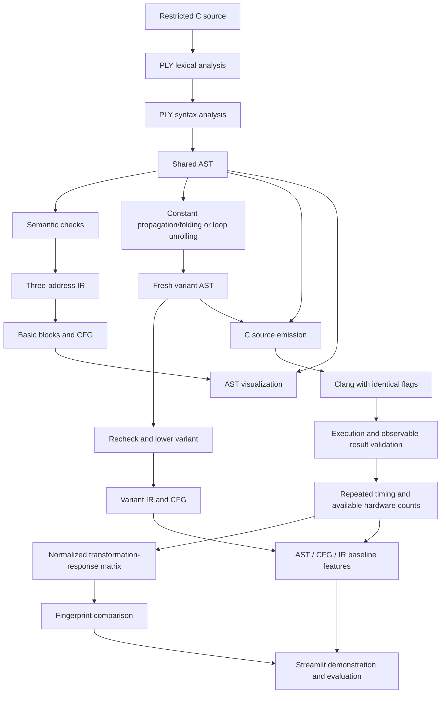

# Architecture

Status: design contract only; no pipeline stages are implemented. Updated
2026-10-09. The current executable behavior is limited to installation smoke tests.

## Research pipeline

AST → CFG is implemented through the common AST → IR lowering in Phase 2.
This avoids two conflicting definitions of branch/loop execution order. Ishaan
owns CFG partitioning and edges; Zayn owns the preceding lowering. The custom
three-address IR is the lab's compiler IR; LLVM IR is a later inspection artifact,
not a substitute for implementing it.

## Boundaries and ownership

The signatures below are **planned APIs**, not callable functions today.
Use Python dataclasses and type annotations, explicit result records, and
schema-versioned JSON. Do not pass PLY-specific objects between stages.

| File / phase | Owner | Planned interface and responsibility |
| --- | --- | --- |
| `compiler/lexer.py` / 1 | Ishaan | `tokenize(source: str) -> list[TokenRecord]`; fresh PLY lexer per source; token value and source span |
| `compiler/parser.py` / 1 | Ishaan | `parse(source: str) -> Program`; PLY grammar, precedence, AST construction; fail with structured diagnostics |
| `compiler/ast_nodes.py` / 1 | Ishaan | Common nodes and `SourceSpan`; `ast_to_dict(program) -> dict` for deterministic structured output |
| `compiler/ir.py` / 2 | Zayn | `validate(program: Program) -> None`, then `lower_ir(program: Program) -> IRProgram`; declarations, symbol scope, defined reads, and real three-address lowering |
| `compiler/cfg.py` / 2 | Ishaan | `build_cfg(ir: IRProgram) -> ControlFlowGraph`; leaders, blocks, typed edges, entry/exit |
| `visualization/graph_renderer.py` / 2 | Ishaan | `ast_to_dot(program) -> str`, `cfg_to_dot(cfg) -> str`, `render(dot, path, format) -> Path`; deterministic DOT, optional external rendering |
| `transformations/constant_folding.py` / 3 | Zayn | `propagate_and_fold(program: Program) -> TransformationResult`; scoped constant environments and safe arithmetic |
| `transformations/loop_unrolling.py` / 3 | Zayn | `unroll_loops(program: Program, max_iterations: int = 32) -> TransformationResult`; conservative eligibility and skipped-loop reasons |
| `compiler/ir.py` / 3 extension | Zayn | `emit_c(program: Program) -> str`; fully parenthesized expressions and stable statement emission from the shared AST |
| `runtime/compiler_runner.py` / 4 | Pranav | `compile_source(source, config) -> CompilationResult`, `execute(artifact, case, config) -> ExecutionResult`; no shell interpolation |
| `runtime/benchmark.py` / 5 | Pranav | `benchmark(variants, cases, config) -> BenchmarkReport`; raw samples, aggregation, validation, and provenance |
| `fingerprint/matrix.py` / 6 | Pranav | `build_matrix(report) -> ResponseMatrix`; schema alignment, normalization, and missing masks |
| `fingerprint/similarity.py` / 6 | Pranav | `compare(left, right, config) -> SimilarityResult`; overlap coverage and defined metrics |
| `app.py` / 7 | All; Pranav integrates | Presentation over those APIs; no duplicate compiler or measurement logic |

The C emitter lives with the shared representation to keep the requested layout
small. Split it into `compiler/codegen.py` only if code size warrants a documented
interface-preserving change. No new module is created merely to reserve a name.

## Shared records

### Frontend and analysis

- `SourceSpan`: one-based line/column positions; zero-based character offsets,
  exclusive end. Preserve original text positions through comments and whitespace.
- `TokenRecord`: token type, typed value, original lexeme, span.
- `Diagnostic`: stage, stable code, message, span if available. Lexing and parsing
  raise dedicated exceptions containing diagnostics; no partial AST on failure.
- `Program`: schema version, one `main` function; nodes described in
  [COMPILER_DESIGN.md](COMPILER_DESIGN.md). Analysis annotations remain separate
  from syntax nodes so transformations do not corrupt the baseline.
- `IRProgram`: ordered instructions, explicit labels, symbol table and source
  provenance. `ControlFlowGraph`: block IDs, instruction lists, typed edges.
  Stable IDs are internal identities, not similarity features.

### Transformations

`TransformationResult` contains a fresh `Program`, pass name/version, parameters,
`status` (`applied` or `not_applicable`), changed-node count, and skip reasons.
The original AST is retained unchanged. Each initial variant applies one pass
independently to the same baseline. Composed passes are a separately labeled
future experiment, since pass order changes responses.

Revalidate transformed ASTs and regenerate their IR/CFG. Constant propagation
and folding are one documented pass initially. Unrolling is a separate pass.
The selection is deterministic in the first study; the title's adaptive pass
selection remains research work and is not an implemented feature.

### Runtime and measurements

`CompileConfig`: compiler path/version, C standard, flags, target and timeout.
Initially use controlled `-std=c11 -O0` experiments to reduce optimizer masking;
`-O2` is a separately labeled evaluation condition, never mixed into one matrix.
Even at `-O0`, trivial programs may yield weak or indistinguishable responses.

`CompilationResult`: success/failure/timeout, exact command, diagnostics, artifact
path, source hash and compiler metadata. `ExecutionCase`: stable ID, stdin bytes,
argument list, environment, fixture/parameter provenance. V1 cases use empty
stdin/arguments and controlled literal source fixtures because user programs
have no input operations. Every variant receives the same case and environment.

`ExecutionResult`: stdout/stderr, process status, termination reason, elapsed
nanoseconds, and full integer return observation when the validation harness is
enabled. POSIX process exit status alone loses return-value information; Phase 3
must validate full returned integers using a reference evaluator or a controlled
C wrapper. A generated wrapper may rename `main` and print its returned `int`;
wrapper code is internal C, outside the accepted user syntax. Apply the same
wrapper to all variants and record it in experiment metadata. Full-return
validation precedes measurement, and successful runs do not prove equivalence
for all possible programs or inputs.

`BenchmarkReport` stores original/variant IDs, applied-pass reports, case IDs,
raw samples, warmups/repetition count, ordered/interleaved run schedule, medians,
dispersion, compiler/OS/CPU/dependency versions and environment. Failed or
non-equivalent variants cannot produce valid fingerprint cells.

Every metric has a value or `null`, unit, backend, scope and missing reason:

| Metric | Unit and scope | Availability |
| --- | --- | --- |
| `wall_time_ns` | Monotonic elapsed wall time; declared process/harness scope | macOS and Linux; includes startup unless a later backend isolates kernel work |
| `hardware_instructions` | Executed hardware instructions; declared `perf` event modifiers and process scope | Linux with working counters and permission |
| `static_tac_instructions` | Count of actual custom IR instructions, excluding labels | Both platforms after IR generation; separate structural baseline |

Never silently substitute one metric for another. Save JSON as the canonical
schema and CSV as long-form rows with explicit statuses; blanks represent
missing values, zero remains a real measurement. Future generated artifacts live
under `results/<run_id>/` and are ignored; deliberately curated evaluation data
can be explicitly versioned after review.

### Fingerprint contract

Rows are named transformations (including their parameters), columns are metric
and execution-case identities. Baseline records are retained separately.
For a finite positive baseline `b` and valid variant value `v`, use
`response = (v - b) / b`. Negative responses mean a reduction. A zero, negative,
missing or non-finite baseline gives a missing cell with a reason. Skipped
transformations are `not_applicable`, not numerical zero. Applied passes with
unchanged measurements can legitimately produce zero.

Compare only compatible schemas, pass versions/parameters, case identities,
metric units/backends and experiment conditions. Compute distances over common
valid cells, expose the common-cell count and coverage, and return unavailable
when overlap is insufficient. Initial candidates are Euclidean distance and
cosine similarity; zero-norm vectors make cosine unavailable. Thresholds are
calibrated against held-out examples, not presented as probabilities or proofs.

## Integration policy

Phase 1 defines the shared AST contract first. Ishaan and Zayn agree on IDs,
scope annotations and label/operand forms before Phase 2 implementation. Zayn
and Pranav agree on emitted variants and full-return validation before Phase 3
acceptance. Phase 3 uses a small test-only Clang/reference harness; production
compilation, subprocess control and timeouts begin in Phase 4. This is validation
support, not early implementation of the runtime package.

Every phase adds unit tests and any justified integration tests, updates progress,
and passes its acceptance gate before the next phase starts. Interface changes
must update this document and affected consumers in the same change. Local setup
uses standard [Python packaging metadata](https://packaging.python.org/en/latest/guides/writing-pyproject-toml/)
and [pytest configuration](https://docs.pytest.org/en/stable/reference/customize.html).

No network services, database or process sandbox is required for the local lab
setup. Future execution accepts trusted local fixtures; exposing compilation of
arbitrary uploads requires a separate isolation decision before deployment.
